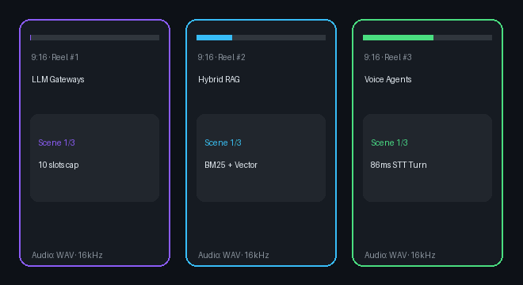

# Agentic Content Factory

[](https://www.python.org/)
[](https://fastapi.tiangolo.com/)
[](app/queue.py)

**Unattended multi-agent pipeline that turns a story idea into a vertical 9:16 video package — script, WAV narration, vertical scene frames, and FFmpeg cut/manifest — across a persistent SQLite job queue.**

<p align="center">
  
</p>

| **5 / 5** | **100%** | **5.2 ms** | **4** |
| :---: | :---: | :---: | :---: |
| queued jobs completed in batch run | end-to-end completion rate | average job orchestration time (without FFmpeg transcode) | isolated agent stages (`Script → Narration → Visuals → Cut`) |

<picture>
  <source media="(prefers-color-scheme: dark)" srcset="docs/img/pipeline-dark.svg">
   Script Agent -> Narration -> Visuals -> Cut Agent" src="docs/img/pipeline-light.svg">
</picture>

Full batch metrics: **[docs/BENCHMARKS.md](docs/BENCHMARKS.md)**.

---

## Quickstart

```bash
python3 -m venv .venv
source .venv/bin/activate
pip install -r requirements.txt

pytest -v
python scripts/bench_queue.py
uvicorn app.main:app --port 8000
```
